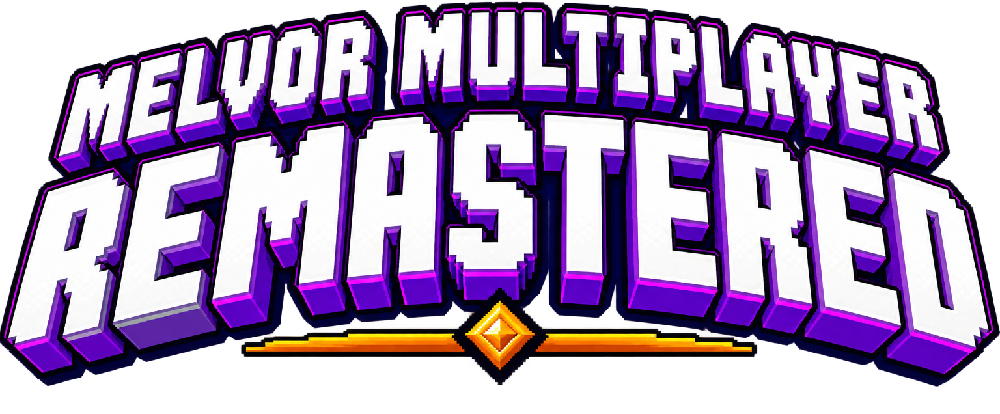

# Melvor Multiplayer Remastered

A community-maintained remaster of the Melvor Idle multiplayer mod, with source for the mod and server.

[Get the mod](https://mod.io/g/melvoridle/m/multiplayer-2026)

## Documentation

- [Player wiki source and independent hosting](wiki/README.md)
- [Self-hosting](docs/self-hosting.md)
- [API reference](docs/api-contracts.md)
- [Repository tools](tools/README.md)
- [Changelog](CHANGELOG.md)
- [Copyright and licensing](NOTICE.md)

## Account recovery privacy

Normal Multiplayer startup uses its own saved credentials. Optional **Account recovery** sends your Melvor Cloud
login token to your selected Multiplayer server only after explicit consent; the token grants access to your Melvor
account, so use this only with a server you trust. The backend verifies it with Melvor and does not store or log the
token or upstream response. Passwords are never requested. A connected profile must enable this feature first;
existing saved credentials and recovery codes remain usable, and account recovery can be disabled in Options.

## Attribution

Based on [Melvor Multiplayer](https://mod.io/g/melvoridle/m/melvor-multiplayer), originally created by Kruithne.
This is an unofficial project, with no affiliation with or endorsement by the original author, Games by Malcs, or Jagex.
